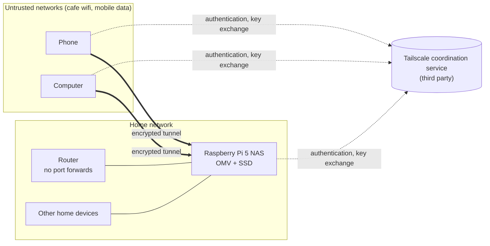

# 01 – Scope and Assets

> **Status:** Draft v0.2 · Last updated: [date]
> **Author:** William Drummond
> **Related:** [02-threat-analysis.md](02-threat-analysis.md) (uses the asset IDs, trust boundaries and phases defined here)
> **Note:** This is a starting draft.

---

## 1. Purpose

This project designs, hardens and documents a home Network Attached Storage (NAS) to replace third-party cloud storage for personal files and device backups. The central question is:

> **How can I access my NAS remotely without exposing it to the internet, and what risks remain?**

It is also a learning exercise and a portfolio piece. The aim is to show a structured approach: define what is being protected, analyse threats, set requirements, harden, and verify the results with evidence.

This documents my own setup and threat model. It is not a universal guide.

## 2. Objectives

| ID | Objective |
|---|---|
| O-1 | Replace third-party cloud storage for personal files, media and device backups |
| O-2 | Provide remote access without exposing any NAS service directly to the internet |
| O-3 | Document each vulnerability or risk I consider, and the reasoning behind each hardening decision |
| O-4 | Provide automated backups from my phone and computer, with a tested restore |
| O-5 | Verify controls with evidence (scans, tests, audit tools) rather than assumption |
| O-6 | Compare two remote access approaches (Tailscale, then self-hosted WireGuard) and record the trade-offs |
| O-7 | Practise a traceable process: threat → requirement → control → test → result |

## 3. Design principles

These guide decisions throughout the project, and I will refer back to them when justifying choices.

1. **Minimise attack surface.** A service that is not reachable cannot be attacked. Prefer not exposing something over defending it
2. **Deny by default.** Block everything, then allow only what is needed
3. **Least privilege.** Each account, device and service gets only the access it needs
4. **Defence in depth.** No single control should be the only thing between an attacker and my data
5. **Verify, do not assume.** Every control needs a test and recorded evidence
6. **Plan for failure.** Assume a device will be lost, a disk will fail and an update will be missed, and make recovery possible
7. **Proportionate effort.** This is a home system, so controls should match the realistic threats rather than an enterprise or nation-state adversary

## 4. Project phases

| Phase | Goal | Key outputs |
|---|---|---|
| **0** | Baseline measurements of the current OMV setup, before any changes | Nmap, `ss`, Lynis and SMART results in `evidence/` |
| **1** | Harden OS, OMV, SSH, firewall, shares and storage, then enable Tailscale access | Requirements, sanitised configs, verification results |
| **2** | Add or replace with self-hosted WireGuard and compare with Tailscale | Comparison write-up, key management procedure |
| **3** | Automated phone and computer backups | Backup design, restore test |
| **4** | Final verification, root cause analysis, residual risk, tutorial | Completed documentation |

## 5. Scope

### 5.1 In scope

- The Raspberry Pi 5, its operating system, OMV and any installed services or plugins
- The SSD and the data stored on it
- Network access to the NAS, from the LAN and through the VPN
- Tailscale and WireGuard configuration, and the trust assumptions of each
- User accounts, shares, permissions and credentials on the NAS
- Admin interfaces (OMV web interface and SSH)
- Backup of phone and computer to the NAS, including the backup tool and its keys
- Monitoring, logging and update processes for the NAS
- Verification evidence (scans, tests) and residual risk
- This repository, including keeping sensitive details out of it

### 5.2 Out of scope

- Router and ISP equipment security beyond the settings that affect the NAS (port forwarding, UPnP, DHCP reservations)
- Hardening of my phone and computer beyond basic assumptions (see section 10)
- Other devices on the home network
- Public hosting of any service, or access for other people
- Multi-user or family use
- Protection against a well-resourced targeted attacker, such as a state-level adversary
- Physical security of the building

### 5.3 Boundary decisions to revisit

| Question | Current position |
|---|---|
| Is the router in scope when checking for accidental exposure? | Yes, for verification only (check port forwarding and UPnP, do not harden the router in depth) |
| Should the NAS be placed on a separate network or VLAN? | To be decided based on router functionality. If the current router does not support this the risk shall be accepted|
| Are the phone and computer in scope? | Only the backup client configuration and the assumptions in section 10 |

## 6. System description

### 6.1 Hardware

| Component | Detail |
|---|---|
| Computer | Raspberry Pi 5 |
| Case | Pironman 5 NAS kit |
| Storage | 1 TB internal SSD, recycled from an old laptop |
| Storage interface | NVMe M2 |
| SSD history | Previously used. Erase and reconfigure for Raspberry Pi|
| Boot media | Micro SD 256 GB|
| Power | 12V.5A (60W) USB type C |

### 6.2 Software

| Component | Detail |
|---|---|
| Operating system | Raspberry Pi OS / Debian base Raspberry Pi OS Lite (64 bit)|
| NAS software | OpenMediaVault (OMV) Version 7.*|
| File sharing | **TO BE DECIDED** |
| Case control software | Vendor-supplied software for the fan, display and lighting Pironman5 module |
| Remote access (Phase 1) | Tailscale |
| Remote access (Phase 2) | Self-hosted WireGuard |
| Backup tooling (Phase 3) | **TO BE DECIDED** |
| Monitoring | **TO BE DECIDED**. Most likely logs and Lynis |

### 6.3 Service inventory (to complete in Phase 0)

Record what actually runs and listens, using `ss -tulpn`, then compare it with what should. Anything unexpected is a finding.

| Service | Typical port | Needed? | Reachable from (target) | Baseline observed **IN PROCESS** |
|---|---|---|---|---|
| OMV web interface | 80 | Yes | LAN and VPN only | |
| SSH | 22/TCP | Yes | LAN and VPN only | |
| SMB file sharing | 445/TCP | Yes | LAN and VPN only | |
| Tailscale client | Outbound connections, UDP. **SUBJECT TO CHANGE** | Phase 1 | Outbound only, no inbound ports |  |
| WireGuard | UDP, port chosen by me | Phase 2 | One UDP port from the internet (documented exception) |  |
| Case control software | Local only. **TO BE CONFIRMED** | Optional | Nothing |  |
| Other (discovery services, media services, etc.) | |  |  | |

### 6.4 Users and roles

| Role | Description | Access needed |
|---|---|---|
| Administrator | Me | Full access via SSH and the OMV admin interface, from LAN and VPN only |
| Standard user | Me (day-to-day account) | Read and write to my shares only |
| Backup client – phone | Automated | Write access to the phone backup location only |
| Backup client – computer | Automated | Write access to the computer backup location only |

Principle: separate accounts for administration, daily use and automated backups, each with the least privilege it needs.
### 6.5 Network and access model

**Current state (baseline):** the NAS is reachable on the home LAN. Backups and tail scale access will be implemented after sufficient hardening of devices

**Target state**
- No ports forwarded on the router in Phase 1, and UPnP disabled
- Remote access only through the VPN
- OMV admin interface and SSH reachable only from the LAN and the VPN
- Phase 2 adds one UDP port for WireGuard as a deliberate, documented exception

## 7. Assets

Impact ratings use **C** = Confidentiality, **I** = Integrity, **A** = Availability, each rated Low (L), Medium (M) or High (H). The question for each is: how bad is it if this is disclosed, altered, or unavailable?

| ID | Asset | Description | C | I | A | Rationale | Related threats |
|---|---|---|---|---|---|---|---|
| A-01 | Personal files | Documents, photos, identificaton documents and other files stored on the NAS  | H | H | M | Private and often irreplaceable. Short outages are tolerable | T-01, 02, 03, 05, 08, 09, 10, 11, 12, 16, 18 |
| A-02 | Phone and computer backups | Backup copies of device data, which may contain app data, messages and saved credentials | H | H | H | Often the most sensitive data, and possibly the only recovery copy. A backup that cannot be restored has no value | T-01, 02, 03, 05, 08, 09, 10, 11, 12, 15, 16, 20 |
| A-03 | Project and portfolio material | Code, write-ups and game projects | M | H | M | Loss of integrity or availability affects my portfolio | T-03, 09, 11, 16, 21 |
| A-04 | Credentials and keys | OMV admin password, SSH keys, share credentials, VPN keys, Tailscale account, backup repository passwords and keys | H | H | M | Compromise gives access to everything else. Losing backup keys means losing the backups | T-01, 03, 04, 05, 06, 07, 08, 15, 16, 17, 21 |
| A-05 | NAS system | Pi, operating system, OMV configuration, installed packages and plugins | M | H | M | Tampering undermines every other control. A compromised NAS could be a foothold on the home network | T-01, 02, 03, 04, 06, 13, 14, 16, 18 |
| A-06 | Home network | Router and other devices on the LAN | M | M | M | A compromised NAS could be used to attack these | T-03, 07, 19 |
| A-07 | Physical hardware | Pi, case kit, SSD | L | L | M | Replacement cost, plus data exposure if stolen unencrypted | T-10, 11, 18 |
| A-08 | Availability of remote access | Ability to retrieve files while away, and for backups to run | L | L | M | Convenience, but also needed for backups | T-17, 20 |

The related threats column links to the threat register in `02-threat-analysis.md`. Update both documents together if the mapping changes.

### 7.1 Data inventory (to complete)

| Data type | Examples | Sensitivity | Stored on NAS? | Notes |
|---|---|---|---|---|
| Identity and financial documents | bank statements | High | No | Consider whether these belong on the NAS at all |
| Personal photos and documents | Identification documents | High | Yes | stronger access controls for sensitive documents and segmentation  |
| Phone backups | Contacts, Files, Photos, applications | High | Yes (Phase 3) | Some applications that offer backup functionality should be considered |
| Computer backups | Files, configuration, snapshots of machine | High | Yes (Phase 3) | snapshots may need to be in a partition with higher access controls |
| Project and portfolio files | Code, game builds | Medium | Yes | mostly public, less sensitive|
| Media | Music, video | Low | Yes | most of what will be kept on the NAS |

## 8. Data flows

| Flow | From | To | Method | Protection (current or target) |
|---|---|---|---|---|
| F-1 | Client on home LAN | NAS | SMB or other **FURTHER ANALYSIS NEEDED** | LAN only. Encryption to be decided |
| F-2 | Client away from home | NAS | Through the VPN tunnel | End-to-end encryption by WireGuard (via Tailscale, then self-hosted) |
| F-3 | Administrator | OMV web interface | HTTP looking at HTTPS later on | Restricted to LAN and VPN. HTTPS to be evaluated |
| F-4 | Administrator | NAS | SSH | Key-based authentication, restricted to LAN and VPN |
| F-5 | NAS and clients | Tailscale coordination service | HTTPS | Authentication, key exchange and device discovery |
| F-6 | Phone and computer | NAS | Backup tool **To BE DECIDED** | Encrypted in transit. Client-side encryption to be evaluated |
| F-7 | NAS | Software update servers | HTTPS | Package signature verification |

## 9. Trust boundaries

1. **Internet ↔ home network.** Nothing from the internet should reach the NAS directly
2. **LAN ↔ NAS.** Other devices on the LAN are not fully trusted (smart devices, guests)
3. **VPN ↔ NAS.** Devices on the VPN are trusted only as far as their access rules allow
4. **Tailscale coordination service.** A third party that distributes keys and network information. Traffic is end-to-end encrypted between devices, but I am trusting the vendor and my account with the identity and configuration of the network
5. **Client devices.** My phone and computer hold access and backup data, but could be lost, stolen or compromised

## 10. Assumptions and constraints

### Assumptions
- I control the router settings and can disable UPnP 
- I am the only administrator and the only person with physical access to the NAS 
- My phone and computer have screen locks, device encryption and receive updates 
- My home network is not already compromised **TO CONFIRM**
- The NAS stays powered on and connected most of the time 

### Constraints
- Limited budget: existing hardware and no dedicated firewall appliance
- The Raspberry Pi 5 limits the performance available for encryption and VPN throughput
- The SSD is second-hand, so its reliability is unknown
- One person maintains the system, so routines must be simple enough to follow consistently
- The ISP may use CGNAT, which would prevent self-hosted WireGuard without extra work, Tailscale may be needed

## 11. Dependencies and third parties

| Dependency | What I rely on it for | Trust consideration |
|---|---|---|
| Tailscale | Connection coordination, key distribution, optional relay servers | Third-party service. See the trust analysis in document 02 |
| Identity provider used to log in to Tailscale | Authentication to my tailnet | Account security directly affects NAS security |
| OpenMediaVault project | NAS software and security updates | Open source. Vulnerabilities need tracking |
| Debian and Raspberry Pi OS | Base operating system and updates | Update process must be reliable |
| Case vendor | Software controlling case hardware | Third-party software running on the NAS. Needs review |
| Home ISP and router | Connectivity and firewalling | CGNAT and router features affect the design |

## 12. Repository hygiene

Because this repository is public and part of my portfolio, nothing sensitive goes into it.

**Never commit:** real IP addresses, hostnames, usernames, MAC addresses, keys, tokens, passwords, backup repository details, or unreviewed screenshots and scan output.

**Practice:**
- Use placeholder values in config examples (for example `192.0.2.x` documentation addresses and `nas.example`)
- Review every scan output and screenshot before committing
- Keep the commit history honest, committing after each stage
- Record AI assistance in `docs/ai-usage.md`

## 13. Success criteria

The project succeeds when:

- [ ] No NAS service is reachable from the internet, except the WireGuard port in Phase 2 (verified by an external scan)
- [ ] Remote file access and backup work through the VPN only
- [ ] Every High-rated threat has a documented treatment, a test and recorded evidence
- [ ] A restore from backup has been tested successfully, including from a version that clients cannot overwrite
- [ ] Before-and-after results exist (for example the Lynis score and the list of open ports)
- [ ] Every control traces to a requirement and a test
- [ ] Residual risks are documented and accepted knowingly
- [ ] The repository contains no sensitive information

## 14. Open questions

- [ ] Which data will be stored, and how sensitive is it?
- [ ] Is my connection behind CGNAT?
- [ ] Does my router support VLANs or guest network isolation?
- [ ] Will the SSD be encrypted, and how will it be unlocked after a reboot?
- [ ] Which backup tool will be used for the phone and the computer?
- [ ] Is there an offline or off-site copy of the backups?
- [ ] What does the case vendor software need to run, and does it need network access?
- [ ] Was the SSD securely wiped before reuse?

## 15. Revision log

| Version | Date | Change | Reason |
|---|---|---|---|
| 0.1 | [date] | Initial short draft | |
| 0.2 | [date] | Added objectives, design principles, service inventory, data flows, data inventory, dependencies, repository hygiene and threat links | More detailed scope requested |
